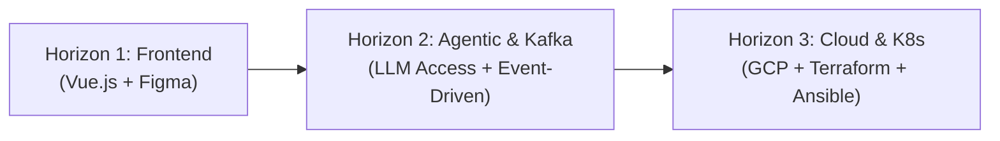
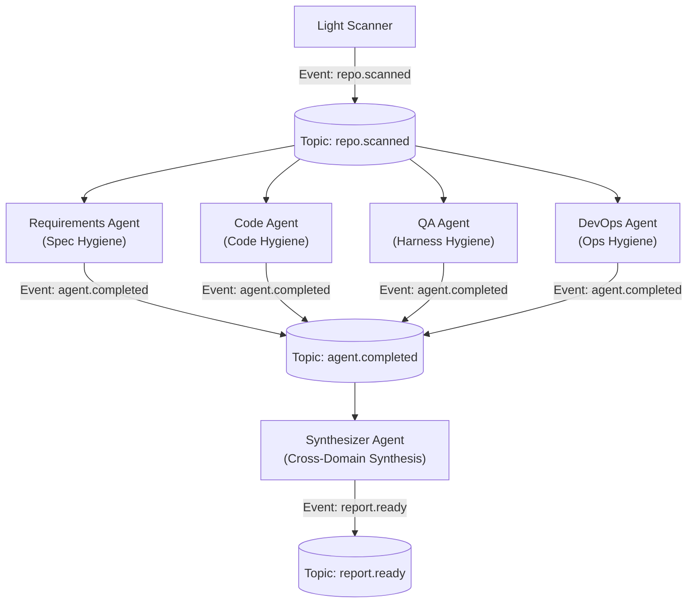
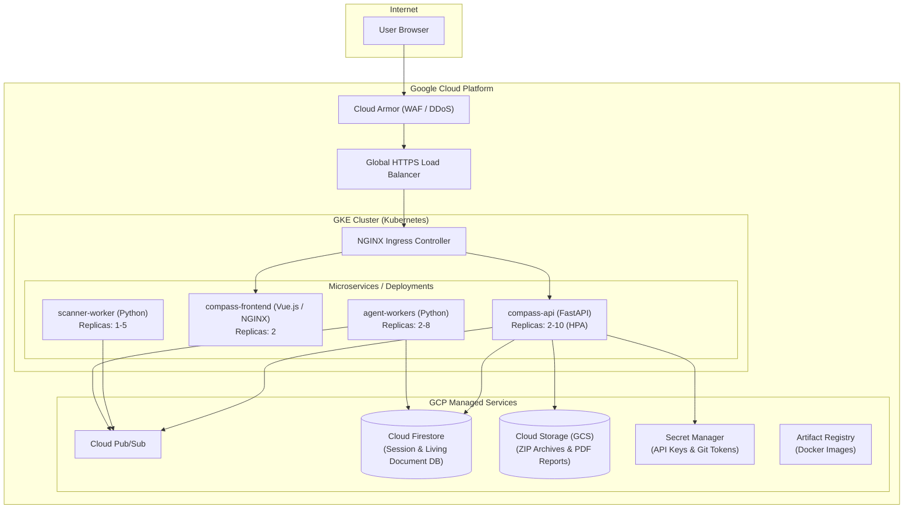

# AI-SDLC Compass — Next Steps Roadmap & Evolution Guide

> **Purpose:** This guide outlines the execution plan to evolve the working V1 prototype into a full enterprise-grade diagnostic platform. It is divided into three progressive horizons based on resource availability, team roles, and cloud budget.

---

## Roadmap Overview



| Horizon | Primary Focus | Prerequisites | Key Deliverable |
| :--- | :--- | :--- | :--- |
| **Horizon 1** | **Vue.js Frontend** | Current working prototype backend | Production Vue 3 SPA connected to API v1 |
| **Horizon 2** | **Advanced Agentic & Kafka** | LLM API keys / compute budget | Event-driven pipeline, streaming agents, post-report chatbot |
| **Horizon 3** | **Cloud & Kubernetes** | GCP / AWS cloud account | Terraform IaC, Ansible automation, GKE cluster, Firestore |

---

## Horizon 1: Implementing the Vue.js Frontend

Your teammate can immediately build the frontend against the running backend using the contract in [`docs/api_contract.md`](./api_contract.md).

### 1. Local Development Setup for the Frontend
1. Start the backend:
   ```bash
   py -m uvicorn backend.main:app --reload --port 8000
   ```
2. The API is live at `http://localhost:8000/api/v1`.
3. Interactive Swagger documentation is accessible at `http://localhost:8000/docs`.

### 2. Vue.js Component Mapping

```
frontend/src/
├── views/
│   ├── Step1ConnectRepo.vue       # POST /api/v1/sessions, POST /sessions/{id}/scan
│   ├── Step2ReviewSignals.vue     # GET /sessions/{id}/signals, PATCH /signals
│   ├── Step3TeamContext.vue       # WebSocket /ws/sessions/{id}/conversation
│   └── Step4ReportView.vue        # GET /sessions/{id}/report, /report/pdf
├── components/
│   ├── SignalCard.vue             # Renders confidence badges + evidence paths
│   ├── ChatBubble.vue             # Specialist agent vs supervisor vs user
│   ├── KnowledgeGapsSidebar.vue   # Live unresolved gap counter + follow-ups
│   └── ScorecardGauge.vue         # 4 SDLC vectors (Spec, Code, Harness, Ops)
└── stores/
    └── diagnosticStore.ts         # Pinia store tracking session_id and lifecycle
```

### 3. Key Frontend Interactions
- **Step 1 (Connect):** Ensure `consent_given: true` is sent in the body. The backend enforces this check.
- **Step 2 (Review Signals):** Render the 6 cards (`languages`, `size_and_structure`, `stack_and_tooling`, `cicd_and_operations`, `quality_indicators`, `warnings_and_gaps`). Allow inline editing via `PATCH /sessions/{id}/signals`.
- **Step 3 (Conversation):** Connect via WebSocket (`/api/v1/ws/sessions/{id}/conversation`) for real-time agent status indicators and typing streams. Fallback to `POST /sessions/{id}/conversation` is available.
- **Step 4 (Report):** Ingest structured JSON from `GET /sessions/{id}/report` and bind directly to the executive verdict card, the 4-dimension scorecard, and the 3 phased recommendation horizons.

---

## Horizon 2: Advanced Agentic Workflow & Distributed Messaging (Kafka / Pub/Sub)

Once LLM provider credits (Vertex AI, OpenAI, or Anthropic) or local GPU resources are secured, evolve the backend from in-process execution to a distributed, event-driven architecture.

### 1. Kafka / Cloud Pub/Sub Event Architecture
Currently, agents run sequentially or via `asyncio.gather`. In high-throughput production, decouple each specialist into independent consumer microservices communicating over event topics:



#### Event Topic Definitions
1. `repo.ingested`: Triggered when Git clone/ZIP extraction finishes. Payload: `session_id`, `workspace_path`.
2. `repo.scanned`: Emitted by Scanner. Contains the 6 signal groups.
3. `diagnostic.turn.submitted`: User submits an answer during Q&A. Broadcast to all agents to update living context.
4. `agent.domain.evaluated`: Each specialist agent publishes its filled TDM and domain score.
5. `report.synthesized`: Final roadmap compiled; triggers PDF compilation and notification.

### 2. Activating Real LLMs (Zero-Code Provider Swap)
The backend abstraction (`backend/llm/`) is already built. To switch from Mock/Ollama to enterprise models, update your `.env`:
```env
# Switch to Google Vertex AI / Gemini
LLM_PROVIDER=google
GOOGLE_API_KEY=your_key_here
GOOGLE_MODEL=gemini-1.5-pro

# OR switch to OpenAI
LLM_PROVIDER=openai
OPENAI_API_KEY=your_key_here
OPENAI_MODEL=gpt-4o
```
No agent or orchestrator code needs to be modified.

### 3. Adding the Post-Report Advisory Chatbot
Once the report is generated, allow the user to ask interactive follow-up questions (e.g., *"How do I implement recommendation rec-2 for my FastAPI routes?"*):
- Vectorize the final report and repository documentation using embeddings.
- Maintain session chat memory.
- Provide step-by-step code snippets tailored to the team's tech stack.

---

## Horizon 3: Enterprise Cloud Infrastructure (GCP, Kubernetes, Terraform, Ansible)

When cloud infrastructure is provisioned (e.g. Google Cloud Platform), deploy the system into a resilient, scalable container platform.

### 1. Target Infrastructure Topology



### 2. Infrastructure as Code (Terraform)
Organize Terraform modules to provision all cloud primitives deterministically:

```
terraform/
├── main.tf                    # GCP provider & backend config
├── variables.tf
├── outputs.tf
├── modules/
│   ├── vpc/                   # VPC network, subnets, Cloud NAT
│   ├── gke/                   # GKE cluster (private nodes, Workload Identity)
│   ├── storage/               # GCS buckets (archives, reports)
│   ├── firestore/             # Cloud Firestore native database
│   ├── pubsub/                # Topics & subscriptions
│   └── iam/                   # Service accounts & least-privilege IAM roles
```

### 3. Server Configuration & Orchestration (Ansible)
Use Ansible playbooks for:
- Initializing local developer environments or self-hosted GitHub Actions runners.
- Hardening container host VMs and bastion instances.
- Configuring monitoring agents (Prometheus node exporter, Datadog/Grafana telemetry).

### 4. Swapping Storage: SQLite → Cloud Firestore
The storage layer (`backend/storage/base_store.py`) is already built as an abstract class. Swapping from local SQLite to Cloud Firestore requires creating `backend/storage/firestore_store.py` that implements `BaseStore`:
- `save_session()` → writes to Firestore collection `sessions/{sessionId}`.
- `save_profile()` → writes to subcollection `sessions/{sessionId}/profile`.
- Zero changes to agent logic or API routers.

---

## Actionable Execution Checklist

| Task | Horizon | Role | Status |
| :--- | :--- | :--- | :--- |
| **Integrate Vue 3 frontend with `/api/v1`** | Horizon 1 | Frontend Dev | Ready to start (API Contract ready) |
| **Connect WebSocket chat in Vue UI** | Horizon 1 | Frontend Dev | Ready to start |
| **Configure LLM API keys in `.env`** | Horizon 2 | Backend Dev | Ready (Provider abstraction active) |
| **Set up Kafka / PubSub topic consumers** | Horizon 2 | Backend/Data | Planned |
| **Implement Post-Report RAG Chatbot** | Horizon 2 | AI Engineer | Planned |
| **Author Terraform modules for GCP/GKE** | Horizon 3 | DevOps/Cloud | Planned |
| **Containerize services into Docker images** | Horizon 3 | DevOps/Cloud | Dockerfiles ready to template |
| **Implement FirestoreStore adapter** | Horizon 3 | Backend Dev | Abstract interface ready |
| **Configure GitHub Actions CI/CD to GKE** | Horizon 3 | DevOps/Cloud | Planned |
